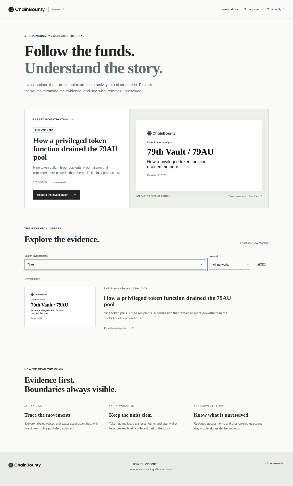
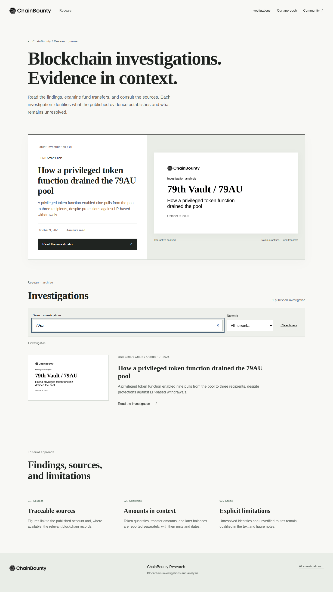
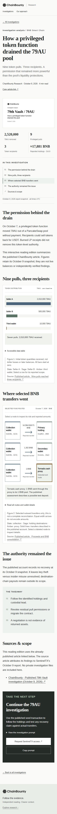
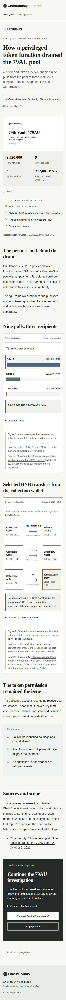
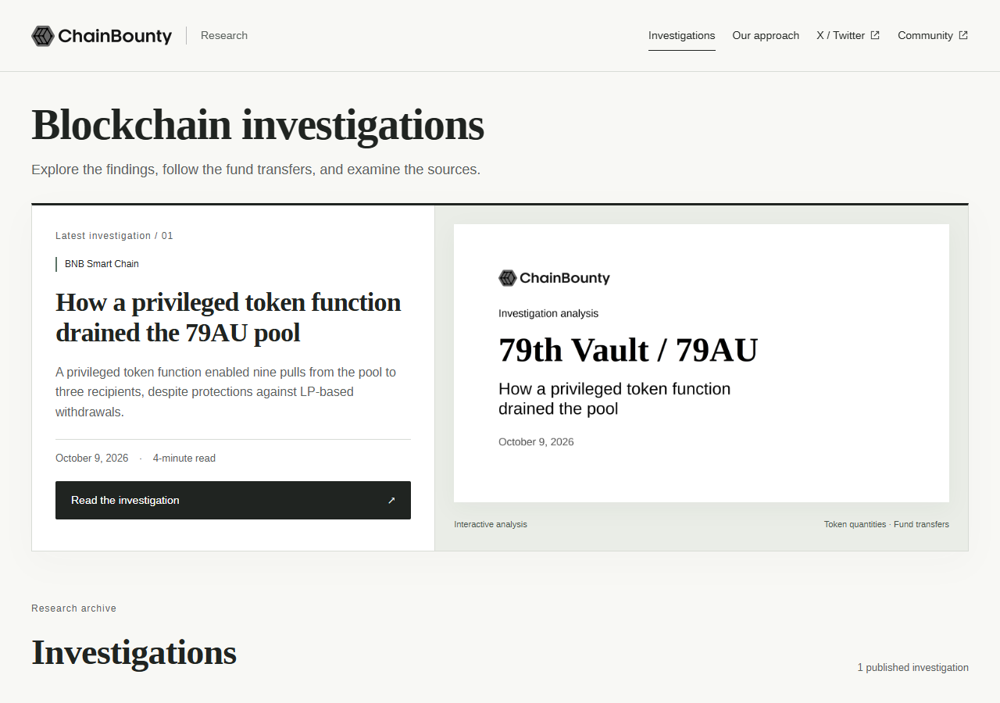
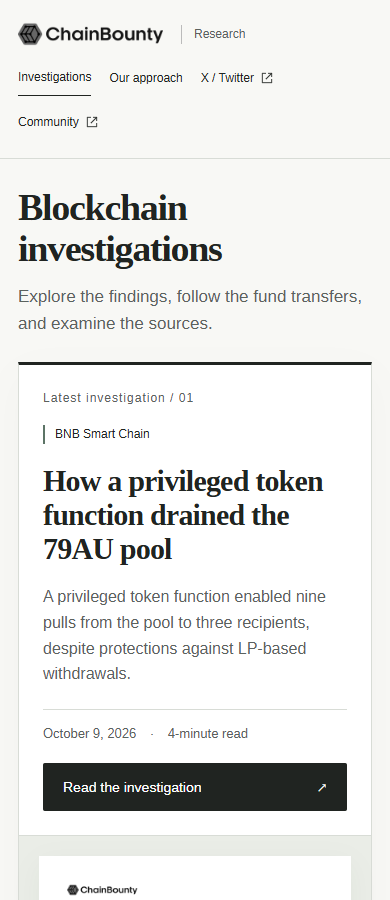
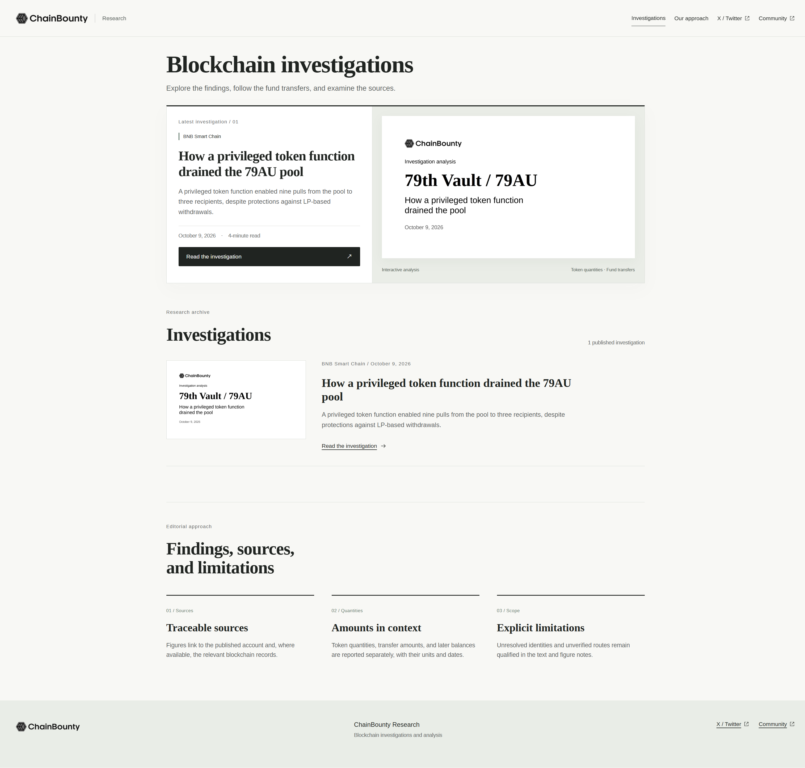
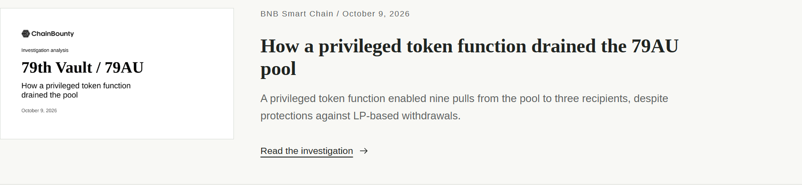

# Editorial and interaction review

## Scope

Chicago-informed house copy and a more deliberate research-publication interface. The locked cover, original logo, fonts, amounts, addresses, source caveats, and public-source boundary remain intact. No Community/X post is edited. This branch is for review, not public deployment.

| Before | After |
|---|---|
| Follow the funds. Understand the story. | Blockchain investigations. Evidence in context. |
| Explore the investigation | Read the investigation |
| Reset | Clear filters |
| 2026-10-09 / 4 min read | October 9, 2026 / 4-minute read |
| Sources & scope | Sources and scope |
| Generic reading-edition source text in the renderer | Required case-specific source note and shared linked attribution format |

The interface adds a quieter monochrome frame, stronger section hierarchy, a persistent desktop navigation bar, and clearer chart controls. Short scroll entrances animate sections, bar lengths, and flow direction. Exact token values remain visible when the optional derived percentages are enabled. Wallets and transfer arrows are selectable by touch, pointer, or keyboard; arrow keys move within each figure.

## Evidence

Screenshots and the interaction recording below are local test captures, not a public deployment. The before images are from the previously validated main-branch design; the after images show this branch. Mobile screenshots are viewport emulation, not a physical iPhone test.

| Desktop before | Desktop after |
|---|---|
|  |  |

| Mobile before | Mobile after |
|---|---|
|  |  |

[Mobile fund-flow detail](docs/review/after-flow.png) · [Short interaction recording (WebM)](docs/review/interaction.webm)

## Verification

- Lint, strict TypeScript, seven unit tests, and the production build pass locally.
- Browser checks cover desktop, 360/390px layouts, keyboard activation, three repeated navigation cycles, clipboard, deep routes, 404, and JavaScript-disabled reading.
- Additional checks cover derived shares, selectable routes, arrow-key focus, back/forward history, reduced motion, missing/throwing observers, and unchanged document height during scrolling.
- A 320px touch test exercises chart controls and wallet selection without page overflow. The minified browser runtime is 4,610 bytes, below the 8 KB test budget; no animation dependency was added.
- A public-source fixture protects exact amounts, metric values, flow nodes/addresses/details, route labels, captions/limitations, conclusion qualifications, CTA seed prompt, and locked cover text.
- Generated cover font hashes, style fingerprint, and measured text bounds pass. Template/font/logo source files have no changes.

This is not a comprehensive accessibility certification or a lab performance score. Physical iOS, screen-reader software, and network-throttled field performance were not tested. Motion uses layout-preserving transforms/opacity and never hides content while waiting for an observer. See the PR checks for the final remote CI result.

Local preview on the Windows desktop: `http://127.0.0.1:4173/`. This address is not reachable from the user's phone. Review images and the recording in this private repository while signed in to GitHub.

## October 12 navigation and viewport refinement

Removed the oversized two-line introduction and journal eyebrow, search input, network filter, reset control, and their client-side state. The archive and article navigation remain. Official X/Twitter and Community links now appear in both the shared header and footer, including mobile. These use small conventional external-link icons; the original ChainBounty logo is unchanged. Existing article and case-investigation CTAs remain without extra promotional buttons.

Independent Chrome measurements found no horizontal overflow before or after at 320, 390, 768, 1024, 1280, and 1440px. The large introduction pushed the featured card below the first desktop viewport: at 1280px, its bottom moved from 1105px to 706px in a 900px viewport. Mobile remains a naturally scrolling single-column page. No fixed-height crop or overflow-hiding workaround was added. Original 16:9 cover content is complete.

The two supplied reference screenshots could not be materialized on Windows: the supported Library helper failed with `AttributeError: module 'os' has no attribute 'setxattr'`, including one consumer-local retry. They were not viewed; the diagnosis above comes from direct local Chrome rendering.

Validation: lint, TypeScript, all 7 unit tests and production build passed. The 16-test Chrome suite covers both channels in both locations, six viewport widths, search absence, cover content ratio, desktop CTA position, skip link, chart keyboard/touch controls, reduced motion, observer failure, clipboard, and repeated navigation. Initial aspect-ratio assertions incorrectly counted the article cover border; the assertion now measures the image content box.

## Native browser viewport and archive link correction

The wide-window blank region was reproduced in visible Google Chrome. The old local preview launcher set a fixed 1440x1000 Playwright viewport inside a 2048x1152 browser window. This limited the page surface independently of window size. With `viewport: null`, the same window exposes a 2034x1058 content viewport (remaining pixels are browser chrome). Root scrolling is HTML; root transform is none, zoom is 1, and no iframe exists. The site's centered 1200px content measure remains intentional; header, background, footer and document scroll occupy the native browser surface. No root width/overflow workaround was added.

The supported `npm run preview:chrome` launcher now uses the native viewport. Visible Chrome resizing from 2048 to 1280 and back to 2048 produced inner widths 2034, 1266 and 2034, with zero overflowing elements. Search inputs remain absent.

The archive link previously inherited the anchor underline into its text arrow, and the arrow span added 15px padding. Only the label is now underlined; a decorative SVG direction arrow sits 8px away. Keyboard activation still opens the article.

Validation: lint, types, 7 unit tests, production build and all 17 Chrome browser tests passed, including 2048px, complete body width, document scrolling, link styling/spacing and keyboard activation. The original cover, logo and article content were unchanged.

